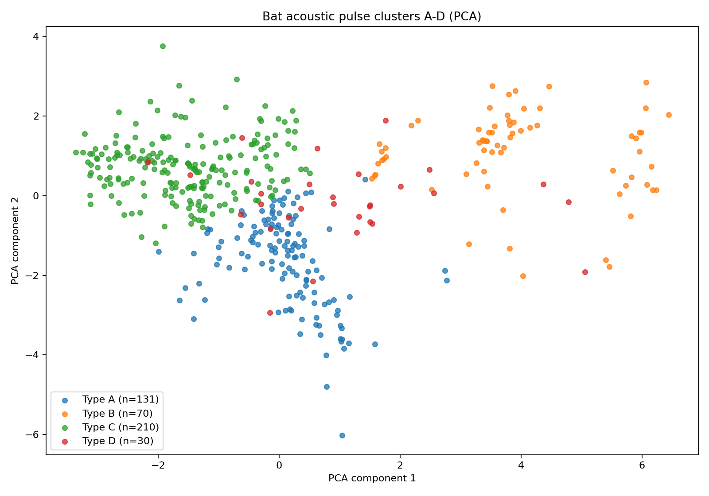
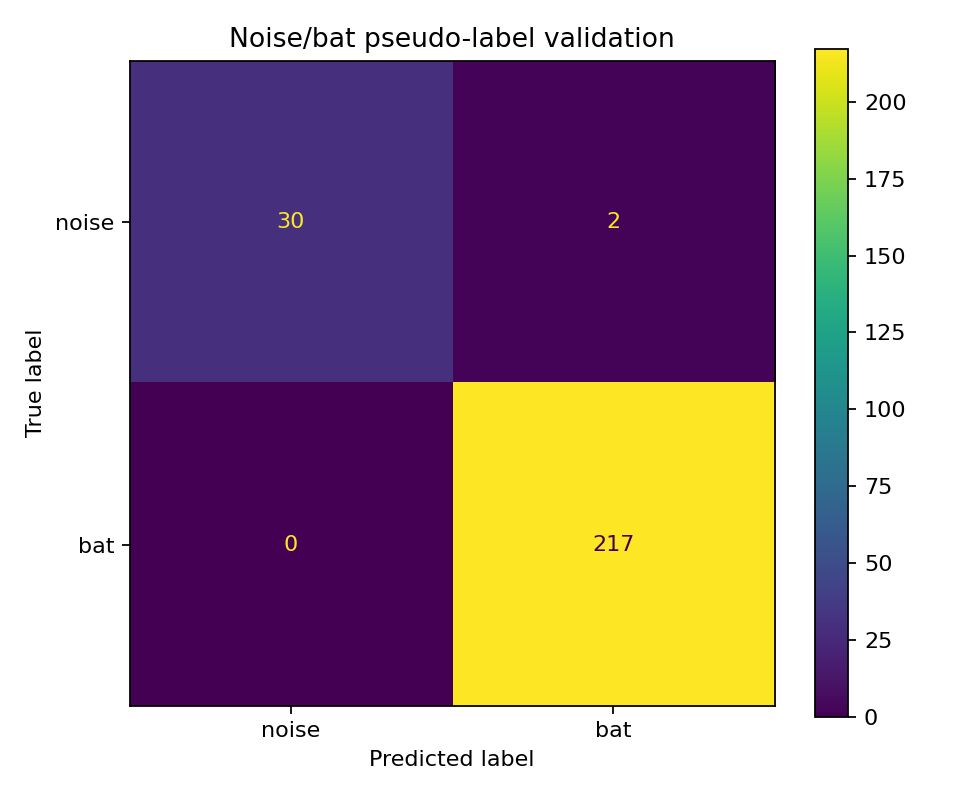

# 蝙蝠超声信号检测与声型分类程序 · 代码结构说明

程序从蝙蝠超声录音（WAV，250 kHz）中自动检测脉冲、提取声学特征，并通过两级模型对新录音分类：第一层判断 noise/bat，第二层把 bat 脉冲归入 A–D 四类声型。A–D 是无监督聚类得到的临时声型标签，不是物种标签。

> **项目定位**：当前版本是声学信号处理与机器学习原型，不是经过专家验证的蝙蝠物种鉴定系统。A–D 代表无监督聚类得到的声型，不能直接写成真实物种。
>
> *蝙蝠超声信号检测与声型聚类系统（自用）
基于Python构建蝙蝠超声录音处理流程，完成高通滤波、候选脉冲检测、频谱追踪及声学特征提取；
提取持续时间、峰值频率、频带宽度、频率斜率、SNR等特征，使用PCA和KMeans探索声型结构；
构建noise/bat筛选与A–D临时声型分类的两级机器学习流程；
在10条共466.88秒录音中检测578个候选片段，筛选得到441个有效脉冲；
开发可直接运行的命令行Demo，并添加端到端冒烟测试及CSV、JSON、结果图输出；
明确当前A–D为无监督临时声型，后续计划接入专家物种标签并采用按录音分组的交叉验证。
>
> ## 数据来源说明

本项目使用的数据来源于本人大学（东北师范大学）导师科研项目中的蝙蝠超声录音数据。

数据主要用于验证蝙蝠声学信号自动检测、特征提取以及机器学习分析流程。
由于当前数据仍处于科研整理阶段，暂未包含完整的专家物种标注信息，因此本项目当前版本重点关注：

- 超声信号自动检测；
- 声学特征提取；
- 无监督声型探索；
- 分类流程原型验证。

当前 A-D 标签表示基于声学特征聚类得到的临时声型，而非经过专家确认的物种名称。

后续获得完整物种标注数据后，将进一步开展：
- 物种级分类模型训练；
- 按录音来源划分的数据验证；
- Precision、Recall、F1 等指标评估。

## 核心功能

- 对 250 kHz WAV 录音进行高通滤波和分块分析。
- 自动检测并精修蝙蝠候选脉冲。
- 实验性分离同一时间段内的近频声波分量。
- 提取持续时间、峰值频率、带宽、频率斜率、SNR 等特征。
- 通过两级流程完成 `noise/bat` 判断与 A–D 声型分类。
- 输出 PCA 图、聚类中心、录音级汇总、模型文件和新录音预测结果。

## 技术栈

Python、NumPy、Pandas、SciPy、Librosa、SoundFile、Matplotlib、scikit-learn、Joblib。

## 数据流程

```text
WAV录音
  → audio_io        读取、重采样、高通滤波
  → detection       候选脉冲检测与边界精修
  → features        特征提取、质量筛选
  → separation      同时近频声波分离（实验性）
  → pulse_table     逐脉冲明细建表
  → noise_gate      第一层 noise/bat 门控训练
  → clustering      第二层 A-D 声型聚类训练
  → prediction      新录音两级预测
  → results/        CSV、JSON、图像、分离音频输出
```

## 可直接运行的 Demo

仓库内置一个 4 秒、约 2 MB 的示例 WAV。它用于展示“候选脉冲检测 → noise/bat 判断 → A-D 临时声型分类 → CSV/JSON 输出”的完整推理流程，不需要下载 167 MB 的原始数据包。

安装依赖后运行：

```powershell
python demo.py --self-test
```

Windows 也可以双击根目录的 `run_demo.bat`。

首次运行会使用仓库已有的两个结果表自动构建演示模型：

- `results/tables/acoustic_pulses.csv`：训练第一层 `noise/bat` 模型；
- `results/tables/acoustic_clusters_ABCD.csv`：训练第二层 A-D 临时声型模型。

默认输入为：

```text
data/sample/demo_xianren_0_4s.wav
```

也可以预测自己的 WAV：

```powershell
python demo.py --input "D:\audio\new_recording.wav"
```

需要强制重新构建演示模型时：

```powershell
python demo.py --rebuild-model --self-test
```

成功后主要输出到：

```text
results/predictions/<文件名>_noise_ABCD.csv
results/predictions/demo_summary.json
results/figures/spectrograms/
results/figures/pulse_zooms/
```

本仓库附带样例在当前测试环境中检测到 61 个有效候选，其中 51 个判为 bat、10 个判为 noise；主要临时声型为 C。该结果只用于验证工程链路可运行，不能解释为真实物种识别结论。测试记录见 [`docs/demo_test.md`](docs/demo_test.md)。

## 快速开始

```powershell
python -m venv .venv
.\.venv\Scripts\Activate.ps1
pip install -r requirements.txt
```

把原始数据按以下任一种方式放置：

- 将 `声波文件.zip` 放到 `data/`；
- 或直接将 WAV 文件放到 `data/raw/`。

然后运行：

```powershell
python run.py
```

训练完成后，可按照终端提示输入一个 WAV 文件或文件夹路径进行预测。

## 各模块功能

### config.py — 路径与参数配置

集中存放全部常量：目录路径与结果表文件名、检测参数（能量阈值 `-28 dB`、脉冲时长 0.8–40 ms、合并间隔、填充余量）、边界精修参数（`CORE_*`）、质量门槛（SNR ≥ 4 dB、轨迹覆盖率 ≥ 0.55 等）、聚类配置（11 个特征列、4 类、单录音样本上限）、分块检测窗口、分离参数（`SEPARATION_*`）、门控参数。调参只需改此文件。

### audio_io.py — 音频读取与频谱基础

- `load_audio`：读取 WAV，重采样到 250 kHz 单声道，去直流、高通滤波、峰值归一化。
- `highpass_filter`：4 阶 butter 高通，滤除 15 kHz 以下背景噪声。
- `calculate_audio_content_hash`：对解码后波形计算 SHA-256，识别内容重复的录音（与文件头无关）。
- `build_spectrogram`：计算功率谱（n_fft=1024，hop=256）。
- `find_wav_files`：递归查找 `.wav` / `.WAV`。
- `ultrasonic_band_mask`、`adaptive_stft_params`、`interval_overlap_ratio`：按片段长度自适应 STFT 参数、超声频段（15–120 kHz）掩码、时间区间重叠比例，供下游多个模块复用。

### detection.py — 候选脉冲检测与边界精修

- `detect_pulses`：对超声频段能量同时施加固定相对阈值和背景自适应阈值，找出候选脉冲区间。
- `merge_active_frames`：把间隔很短的活动帧合并成连续区。
- `select_group_containing_peak` + `refine_pulse_boundary`：在候选区内部重新定位高信噪比脉冲核心，去掉前后背景拖尾。
- `refine_all_pulses`：批量精修，并按重叠比例 ≥ 0.60 去重。
- `remove_duplicate_boundary_pulses`：删除分块重叠区域重复检测到的同一脉冲（重叠 ≥ 0.50 或中心距 ≤ 1.5 ms）。
- `detect_and_refine_pulses_chunked`：长录音按 4 秒窗口取首/中/尾分块检测，再合并去重，缩短演示运行时间。

### features.py — 单脉冲特征提取与质量筛选

- `extract_pulse_features`：只在可靠高能量帧上计算峰值频率、起止频率、频率下降幅度、f05/f95、90% 带宽、频率斜率、主导频率轨迹覆盖率、最大跳频、RMS。
- `evaluate_pulse_quality`：与物种无关的通用质量门槛，返回接受/拒绝及原因（low_snr、low_track_coverage、unstable_frequency_track、peak_frequency_out_of_range）。
- `weighted_frequency_quantile`：功率加权频率分位数。
- `accepted_mask`：兼容布尔列和 CSV 读回的字符串布尔列。
- `numeric_feature_frame`：特征列统一转数值并把 ±inf 替换为 NaN。

### separation.py — 同时近频声波分离（实验性）

- `_link_spectral_peak_tracks`：逐帧寻找频谱局部峰，用带速度预测的贪心匹配连成频率轨迹。
- `_compare_simultaneous_tracks` / `_tracks_are_harmonic_duplicates`：判断两条轨迹是否时间重叠足够、中位频率差可分辨、排除二/三次谐波误判。
- `separate_simultaneous_pulse_components`：确认存在 ≥ 2 条独立轨迹时，按高斯软掩码把混合波形拆成多条分量音频；否则原样返回，避免对普通单脉冲造成失真。
- `save_separated_pulse` / `clear_separated_pulses_for_source`：分离分量 WAV 的写盘与重建前清理。

### pulse_table.py — 数据准备与逐脉冲建表

- `prepare_demo_dataset`：创建全部输出目录；`data/raw` 无 WAV 时从 `data/` 下的压缩包解压。
- `create_demo_pulse_rows`：对每个精修候选尝试分离，逐分量提取特征并做质量筛选；若分离出的分量通不过质量门槛则回退为原混合脉冲。
- `build_demo_pulse_table`：遍历全部录音（内容哈希去重），生成逐脉冲明细 `acoustic_pulses.csv` 和录音级检测汇总。

### visualization.py — 图像输出

- `save_fast_overview_spectrogram`：整段录音概览声谱图，时间帧数限制在约 4000 以内。
- `save_top_pulse_zoom_grid`：能量最强的若干脉冲放大图，叠加每帧主导频率轮廓线。
- `save_pca_plot`：A-D 聚类的 PCA 二维散点图。
- 导入本模块即完成 matplotlib Agg 后端与中文字体设置。

### clustering.py — A-D 声型聚类

- `prepare_cluster_data`：只取合格脉冲，数值清洗，限制单个录音最多贡献 150 个脉冲。
- `standardize_cluster_centers` + `create_acoustic_type_mapping`：在四个聚类中心之间标准化，按 FM 型 / CF 型 / 低频窄带评分把无意义的 KMeans 编号稳定映射为 A-D。
- `cluster_acoustic_types`：标准化 + KMeans（k=声型数量）、PCA、轮廓系数，保存聚类模型 `.joblib` 与元数据 JSON（含 `trained_at` 训练时间与中文摘要 `summary_zh`）。
- `train_temporary_classifier`：训练复现 A-D 标签的临时随机森林（600 棵），输出与聚类标签的一致率。
- `save_cluster_representatives`：每类取距中心最近的 10 个代表脉冲，复制到 `cluster_examples/声型A-D/`。
- `create_recording_cluster_summary`：统计每段录音中 A-D 的数量与占比。

### noise_gate.py — 第一层 noise/bat 门控

- `prepare_noise_gate_data`：用质量筛选结果生成原型伪标签（accepted→bat，rejected→noise），按录音×类别限量保留，两类都保留靠前的难样本。
- `make_noise_gate_model` / `train_noise_gate`：随机森林（600 棵），≥ 4 个独立录音时按录音分组留出 25% 验证，保存模型与验证明细 CSV。
- `apply_noise_gate`：对新候选批量输出 bat/noise 概率，按阈值 0.55 判定。

### prediction.py — 新录音两级预测

- `predict_one_demo_wav_two_stage`：单个 WAV 完整走 检测 → 分离 → 门控 → A-D 分类，写出逐片段预测 CSV、概览声谱图和放大图，返回汇总 dict。
- `predict_demo_path_two_stage`：支持单个文件或整个文件夹，写出预测汇总 CSV。

### pipeline.py — 完整流程编排

`run_full_training(labels, type_descriptions, data_source)`：数据准备 → 脉冲建表 → 门控训练 → 聚类训练 → 合并保存两级模型 `noise_bat_ABCD_model.joblib`，返回合并 payload；供 CLI 与桌面 App 共同调用。`main()` 在此基础上保留交互式路径输入。只做流程串联，算法细节都在各功能模块。

### demo.py — 轻量演示

从 `results/tables/` 已提交的两个结果表（`acoustic_pulses.csv`、`acoustic_clusters_ABCD.csv`）重建小规模两级模型（随机森林 300/400 棵，与 pipeline 的 600 棵不同，是有意设计），无需原始录音数据即可复现演示。含 argparse CLI：`--input`、`--model`、`--rebuild-model`、`--self-test`。

## 桌面 App（bat_classifier_app.py）

PySide6 窗口程序，四页签，所有耗时操作在后台线程执行、日志回显到底部面板：

| 文件 | 功能 |
|---|---|
| `src/bat_classifier/app/settings.py` | 工作区/标签/数据源设置，持久化到 `workspace/app_settings.json`；启动时先写入 `BAT_WORKSPACE` 环境变量再导入库（config 路径在导入期解析） |
| `src/bat_classifier/app/workers.py` | QThread 工作类（导入数据/训练/预测），stdout 重定向为 Qt 信号 |
| `src/bat_classifier/app/image_viewer.py` | 结果图像查看：大图对话框（适应窗口/1:1）与"列表+预览"画廊组件 |
| `src/bat_classifier/app/main_window.py` | 五页签主窗口：①数据来源（选 WAV 文件夹或 zip，导入到 `data/raw`）②模型训练（声型数量 2–6、标签名与描述可编辑、可选诊断图）③预测（选 WAV/文件夹，结果表格预览）④模型管理（中文训练摘要、原始元数据 JSON、模型目录）⑤结果图像（声谱图/脉冲放大图/PCA 图的浏览与大图查看） |

- 运行：`python bat_classifier_app.py`；`--selftest` 离屏自检（供打包验证）。
- 标签规则：默认 A-D 四类沿用语义归类；其他数量或名称按聚类中心峰值频率从低到高依次分配。
- 工作区：源码态默认为仓库根目录；打包态为 exe 旁的 `workspace/`，含 `data/raw`、`results`、`models`。
- 打包：`build_exe.bat`（内部执行 `pyinstaller bat_app.spec --noconfirm` 并对产物跑 `--selftest`），产物 `dist/BatClassifier/BatClassifier.exe`。

## 入口与测试

| 文件 | 作用 |
|---|---|
| `run.py` | 完整训练流程入口：`python run.py` |
| `demo.py`（根目录） | 演示入口：`python demo.py --self-test` |
| `run_demo.bat` | Windows 双击运行演示（内部调用 `demo.py --self-test`） |
| `src/bat_classifier/__main__.py` | 支持 `python -m bat_classifier` |
| `tests/test_demo_smoke.py` | 端到端冒烟测试：临时目录建模、跑内置样例 WAV、检查输出文件 |

## 输出目录

| 目录 | 内容 |
|---|---|
| `results/tables/` | 脉冲明细、检测汇总、聚类结果、聚类中心、代表脉冲、录音声型汇总、门控验证明细 |
| `results/figures/` | 概览声谱图、脉冲放大图、PCA 图、`cluster_examples/`（每类代表脉冲） |
| `results/audio/separated_pulses/` | 分离出的分量音频 |
| `results/predictions/` | 新录音逐片段预测 CSV 与 `demo_summary.json` |
| `models/` | 门控模型、A-D 聚类模型及元数据、合并两级模型 |
| `data/raw/` | 原始演示 WAV（本地，不提交）；`data/sample/` 内置 4 秒演示 WAV |

## 当前原型运行结果

本仓库附带一次本地样例运行的汇总结果：

| 指标 | 结果 |
|---|---:|
| 原始录音 | 10 条，共 466.88 秒 |
| 检测到的候选片段 | 578 个 |
| 通过质量筛选的脉冲 | 441 个 |
| 被拒绝的噪声/低质量片段 | 137 个 |
| A/B/C/D 声型数量 | 131 / 70 / 210 / 30 |
| KMeans 轮廓系数 | 0.295 |
| noise/bat 原型伪标签一致率 | 99.20% |
| 临时随机森林复现聚类标签一致率 | 96.40% |

轮廓系数 0.295 表明四类声型存在一定结构，但组间仍有明显重叠。因此，这个结果适合证明流程可行，不足以证明四个自然物种被清晰分开。两个“一致率”衡量的是模型对当前规则标签或聚类标签的复现能力，也不是真实物种识别准确率。

### PCA 声型分布



### noise/bat 原型伪标签验证



详细汇总见 [`results/tables/experiment_summary.csv`](results/tables/experiment_summary.csv)、[`recording_cluster_summary.csv`](results/tables/recording_cluster_summary.csv) 和 [`cluster_centers_ABCD.csv`](results/tables/cluster_centers_ABCD.csv)。

## 当前评估说明

当前第一层 `noise/bat` 标签主要来自自动质量规则，A–D 来自 KMeans 聚类。因此，内部验证分数只能说明模型能否复现这套原型标签，不能当成真实物种识别准确率。正式物种分类需要老师或专家确认的标签，并按“原始录音”分组划分训练集与测试集。

正式版本建议至少报告：
- 录音数量、有效脉冲数量与各类别样本量；
- 宏平均 Precision、Recall、F1；
- 混淆矩阵；
- 按录音分组的交叉验证结果；
- 未见过地点或设备上的外部测试结果。

## 测试

目前已提供 Demo 端到端测试：

测试内容：
- 模型自动构建；
- 示例音频读取；
- 超声脉冲检测；
- noise/bat 两级预测；
- 结果文件生成。
运行：
python -m unittest tests.test_demo_smoke -v

后续计划增加：
- 特征提取单元测试；
- 异常输入测试；
- 不同录音条件稳定性测试。


## 项目亮点
针对野外蝙蝠监测中人工鉴定成本高的问题，设计基于声学信号特征的自动分类方法。
为减少野外录音人工筛查工作量提供自动化原型。

## 已知限制与下一步

1. 获取可靠物种标签，替换 A–D 临时声型。
2. 增加不同地点、设备、距离和背景噪声条件下的数据。
3. 增加命令行参数，取消交互式路径输入。
4. 提供 1–3 个可公开示例 WAV 和可复现的基准结果。

## 工程优化计划

当前版本已完成：

- 数据读取；
- 信号预处理；
- 脉冲检测；
- 特征提取；
- 聚类分析；
- 模型预测；

完整流程集中管理，便于科研实验迭代。

后续工程化版本计划进一步拆分：

- audio_processing.py
- feature_extraction.py
- clustering.py
- classifier.py
- visualization.py

提高代码复用性和维护性。

更完整的方法说明见 [`docs/methodology.md`](docs/methodology.md)。
>
